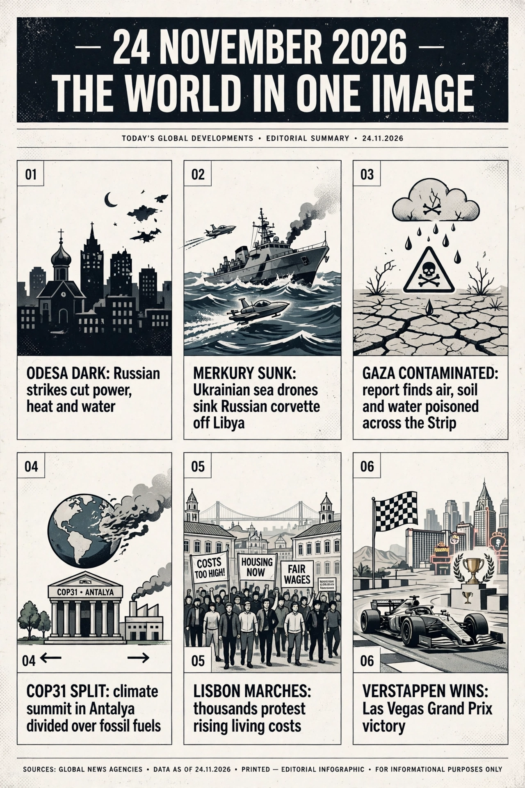

# The World in One Image — 24 November 2026

One image summing up world news on 24 November 2026.

## The six stories

1. Odesa dark — Russian strikes cut power, heat and water in Odesa.
2. Merkury sunk — Ukrainian sea drones sink a Russian corvette off Libya.
3. Gaza contaminated — a report finds air, soil and water poisoned across the Strip.
4. COP31 split — the climate summit in Antalya is divided over fossil fuels.
5. Lisbon marches — thousands protest rising living costs.
6. Verstappen wins — Las Vegas Grand Prix victory.

## The image

The entry image (`entry.png`) is a six-panel editorial infographic, one panel
per story, drawn from the day's live news. `main.ts` copies it to
`/output/entry.png` at run time.

Entry for the make.fun bounty "Sum up 24 November's world news in one image"
(https://make.fun/bounty/news-image-20261124).
